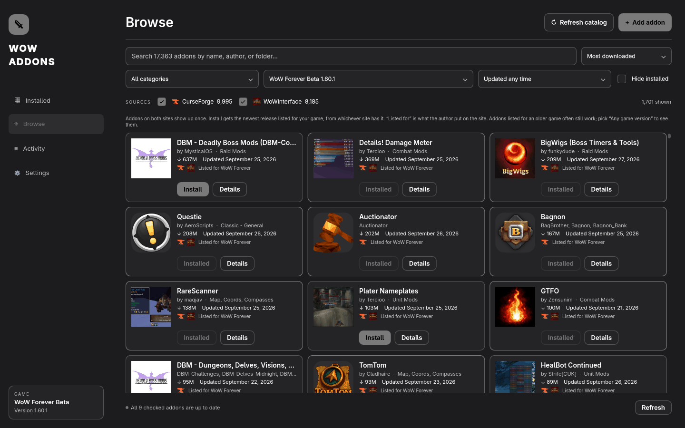
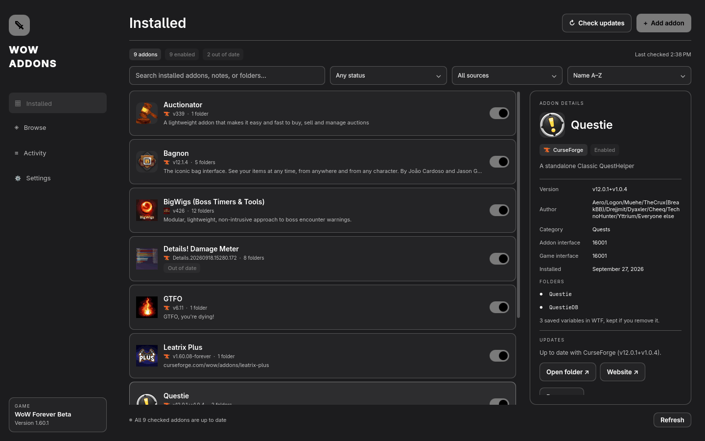

# WoW Addons

An addon manager for World of Warcraft on [Omarchy](https://omarchy.org). Browse addons from CurseForge and WoWInterface, install them in one click, and keep them up to date. You don't need the CurseForge app or an account.



## Install

Built for Omarchy 4.x with Quickshell and Python 3. The installer checks for
both commands and Omarchy's shell theme module at
`/usr/share/omarchy/shell/Commons`.

```bash
git clone https://github.com/ztrek7/omarchy-wow-addons
cd omarchy-wow-addons
python3 scripts/install.py
```

Open **WoW Addons** from the app launcher (**Super + Space**).

## Use

1. Choose your game in **Browse** or **Settings**. The app looks in common Wine
   and Proton prefixes; if it misses yours, choose the World of Warcraft folder
   in Settings. Check the detected game and version before installing addons.
2. Search or filter **Browse**, select an addon, and install it. The app also
   tries to install required addons from its supported sources.
3. Use **Installed** to update, disable, or remove addons. Updates are checked
   when the app opens and every six hours while it stays open.



Disabling moves addon folders to `Interface/AddOns.disabled`, affecting every
character. Removed or replaced addons go to the trash; settings in the game's
`WTF` folder are left alone. If WoW is open, type `/reload` after changes.

## Sources and limits

- **CurseForge and WoWInterface** are the supported download sources. Wago
  downloads and arbitrary download links are not supported.
- Game labels come from the sites' listings, not a promise that an addon works
  with your client. **Any game version** can expose addons listed for other games.
- CurseForge listings depend on community catalog data and CFWidget. When a
  file list is stale, the app refuses it and may use a suitable WoWInterface
  listing instead. If neither works, download the ZIP yourself and add it.
- **ZIPs imported through the app do not receive automatic updates.** Addons
  copied into the game by hand can be checked when their metadata identifies a
  supported source that lists them for your game.
- If two version strings cannot be reliably ordered, the app reports that
  instead of offering a possible downgrade.

See the [reference](docs/REFERENCE.md) for catalog behavior and stored files.

## Update the manager

Addon updates inside the app do not update the manager itself. Close WoW Addons,
then run these commands from your original checkout:

```bash
git pull --ff-only
python3 scripts/install.py
```

Reopen **WoW Addons** from the launcher after installation finishes. The installer
**copies** the checkout to `~/.local/share/wow-addons/app` (or under
`XDG_DATA_HOME`), so `git pull` alone does not update the installed app. Reinstalling
replaces that app copy and refreshes its launcher and icon; it leaves addons,
settings, and state intact. Review source changes before reinstalling.

## Remove the manager

From the checkout:

```bash
python3 scripts/install.py --uninstall
```

This removes the app, launcher entry, and icon. Your addons, settings, and state remain.

## Problems and development

Open an [issue](https://github.com/ztrek7/omarchy-wow-addons/issues/new/choose).
Use **Settings → Copy details for a report** to collect useful diagnostics.
See [CONTRIBUTING.md](CONTRIBUTING.md) for offline tests and running from a checkout.

## License

MIT. The CurseForge and WoWInterface logos belong to those sites. They're only used to show where an addon comes from.

This project isn't affiliated with Blizzard Entertainment, CurseForge, WoWInterface, or Wago. World of Warcraft is a trademark of Blizzard Entertainment, Inc.
